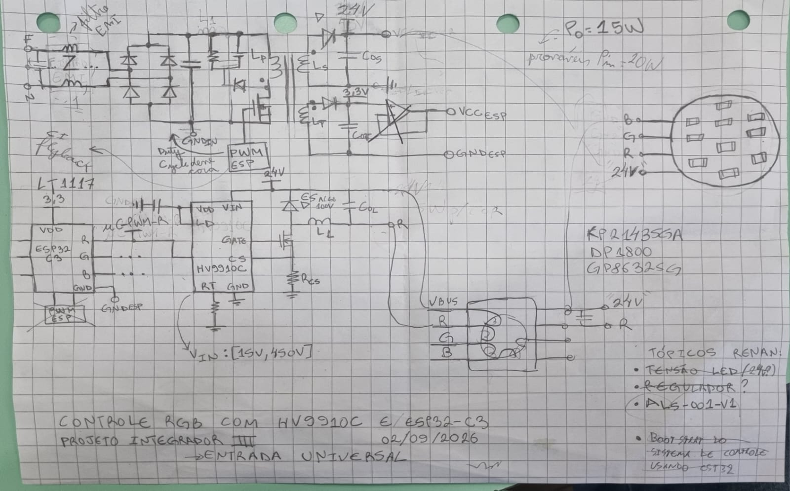

# Bralight — Controladora LED RGB

Repositório dedicado ao registro e desenvolvimento do firmware para controle da luminária **Bralight**, baseado no microcontrolador **ESP32-C3** rodando **MicroPython** e integrado ao **Home Assistant** via **MQTT**.

---

## 🎯 Objetivo

Centralizar o código-fonte, a arquitetura de comunicação e a documentação de hardware da controladora de iluminação RGB da luminária Bralight.

---

## 🔌 Arquitetura e Hardware

### Esquema do Circuito


### Pinagem PWM (ESP32-C3)
| Canal | Cor | GPIO |
| :--- | :--- | :--- |
| **R** | Vermelho (Red) | `GPIO0` |
| **G** | Verde (Green) | `GPIO1` |
| **B** | Azul (Blue) | `GPIO3` |

---

## ⚙️ Estrutura e Comunicação

O sistema opera de forma distribuída na rede local utilizando o protocolo **MQTT**:

* **Broker MQTT:** Hospedado via Mosquitto (`192.168.0.159:1883`), responsável por intermediar as mensagens entre a interface e o hardware.
* **Interface de Controle (Home Assistant):** Acessível localmente pelo painel em [http://192.168.0.4:8123/light?historyBack=1](http://192.168.0.4:8123/light?historyBack=1), publicando comandos RGB no tópico `casa/luminaria/rgb`.
* **Firmware (ESP32-C3):** Escrito em MicroPython (`src/main.py`), conecta-se ao Wi-Fi (com *Access Point* de fallback automático), subscreve no tópico MQTT e converte os valores `R,G,B` (0–255) em sinais PWM de 10 bits (0–1023).

---

## 🚀 Como Executar e Testar

A forma mais prática de transferir e executar o código MicroPython no **ESP32-C3** é utilizando a ferramenta `mpremote`:

1. **Instalar a dependência MQTT (apenas na primeira configuração):**
   ```bash
   mpremote mip install umqtt.simple